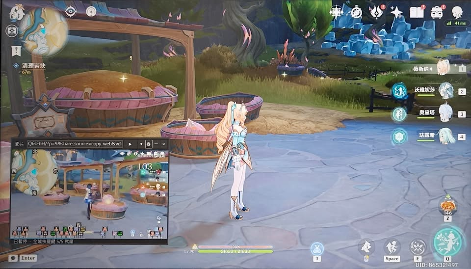
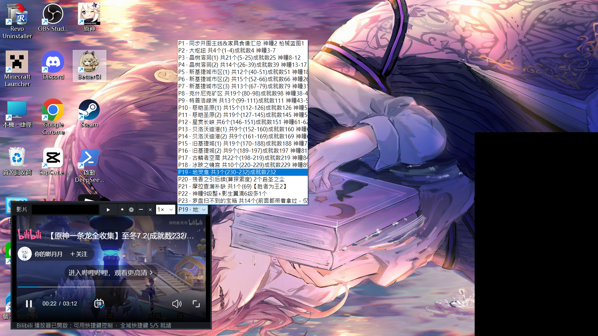

# 懸浮影片播放器 v9

可貼入 MP4／WebM、YouTube、Bilibili 影片網址及 b23.tv 分享短連結，按視窗上方的 ▶ 載入。視窗可拖動、縮放及置頂。影片控制使用全域快捷鍵；下方沒有額外進度條或控制按鈕。

可以直接貼上含標題的 Bilibili 分享文字；按 ▶ 後會自動擷取其中的網址，並保留 `?p=6` 這類分 P 參數。

## 實用案例

- **邊玩遊戲邊跟攻略**：把 Bilibili 或 YouTube 攻略縮小放在畫面一角，按 ◆ 置頂。找寶箱或解謎時，可以維持遊戲焦點，用快捷鍵暫停，或倒轉 10 秒重看路線。若獨佔全螢幕模式看不到播放器，可將遊戲切換成無邊框視窗模式。
- **跟著教學操作軟體**：把教學影片放在編輯器或繪圖軟體旁，每做完一步再用快捷鍵繼續播放。遇到操作太快的地方，可以直接倒轉重看。
- **查資料時看長影片**：把訪談或講座縮到螢幕角落，一邊瀏覽網頁或做筆記，一邊用快捷鍵調整音量、暫停或快轉。

## 使用截圖

**邊玩遊戲邊跟攻略**。將懸浮播放器置頂於畫面左下角，一邊對照影片路線，一邊在遊戲中操作。



**從選單切換 Bilibili 分 P**。打開分 P 選單查看各集標題，選擇後會載入對應的影片。



## 倍速與 Bilibili 分 P

使用上方的倍速選單，可在 0.25× 到 2× 之間調整。YouTube 可用倍速由影片播放器決定。

載入 Bilibili 多分 P 影片後，上方會顯示分 P 選單。選擇集數會更新網址的 `p=` 參數，並立即載入選中的分 P。若 Bilibili 無法提供清單，仍可在網址欄手動修改 `p=` 後重新載入。

## 快捷鍵

| 功能 | 預設快捷鍵 |
| --- | --- |
| 播放／暫停 | Ctrl + Alt + Space |
| 倒轉 10 秒 | Ctrl + Alt + ← |
| 快轉 10 秒 | Ctrl + Alt + → |
| 降低音量 5% | Ctrl + Alt + ↓ |
| 提高音量 5% | Ctrl + Alt + ↑ |

按 ⚙，點選欄位後直接按單一鍵或組合鍵即可重新設定，無須輸入按鍵名稱。Delete 清除；Esc 取消當次錄製。設定的快捷鍵在播放器失焦或最小化時仍可使用。單一鍵會在其他程式中占用該按鍵；若與系統或其他程式衝突，狀態列會顯示註冊失敗，請改用另一個鍵。

## 安裝與限制

從 GitHub Releases 下載 `FloatVideo-v9-win-x64.exe`，雙擊即可啟動，無需解壓縮或安裝。

Bilibili 直播頁、專欄頁不在支援範圍；需要登入、付費或受地區限制的影片，可能無法在官方站外播放器中觀看。若未自動播放，請先點擊影片畫面。

需要 Windows 10/11 x64 與 Microsoft Edge WebView2 Runtime。單檔 EXE 已內含 .NET 執行環境。設定存在 `%LOCALAPPDATA%\FloatVideo\settings.json`。

## 從原始碼建置

在 Windows 上使用 .NET 7 SDK，於專案根目錄執行：

```powershell
dotnet publish FloatVideo.csproj -c Release -r win-x64 --self-contained true -p:PublishSingleFile=true -p:IncludeNativeLibrariesForSelfExtract=true -p:EnableCompressionInSingleFile=true -p:DebugType=None
```

從發佈目錄執行 FloatVideo.exe。

## 授權

本專案採用 [MIT License](LICENSE)。
